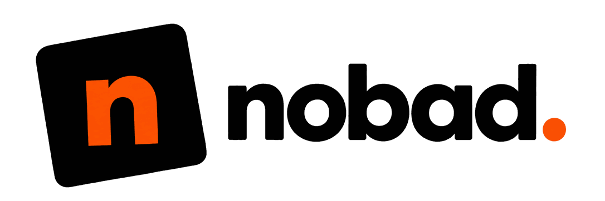

<picture>
  <source media="(prefers-color-scheme: dark)" srcset="https://raw.githubusercontent.com/nobad-studio/.github/main/profile/nobad-logo-light.png">
  
</picture>

<h3 align="center">Software with a point of view.</h3>

An independent, open-source software studio. Free tools that protect you, explain themselves and
never claim more than they measure.

## Products

| | | |
|---|---|---|
| **[NOBAD VPN](https://nobad-platform.nobad-studio.workers.dev/products/vpn/)** | WireGuard VPN for Windows with a kill switch, DNS leak block, Network Intelligence and an Evil Twin check. | [`Nobad-VPN`](https://github.com/nobad-studio/Nobad-VPN) · stable |
| **NOBAD Find** | Private, offline search for everything on your PC: names, the text inside files, and meaning. | [`Nobad-VPN`](https://github.com/nobad-studio/Nobad-VPN/tree/main/apps/find) · in development |
| **[NOBAD File Bridge](https://nobad-platform.nobad-studio.workers.dev/products/file-bridge/)** | Open, copy, edit and back up the files on your website or server, right from your PC. | [`file-bridge`](https://github.com/nobad-studio/file-bridge) · in development |

Website: [`website`](https://github.com/nobad-studio/website) · [nobad-platform.nobad-studio.workers.dev](https://nobad-platform.nobad-studio.workers.dev/)

## Contribute
Everything is built in the open, and contributions of every size are welcome.
1. **Fork** the repository and make your change on a branch.
2. Open a **pull request**. On your first one, a bot asks you to sign the [CLA](https://github.com/nobad-studio/.github/blob/main/CLA.md) with one comment.
3. Start with a [`good first issue`](https://github.com/search?q=org%3Anobad-studio+label%3A%22good+first+issue%22+state%3Aopen&type=issues),
   or ask in a repository's Discussions.

Code is [MIT licensed](https://github.com/nobad-studio/Nobad-VPN/blob/main/LICENSE). Forks are welcome; published forks use
their own name ([brand policy](https://github.com/nobad-studio/.github/blob/main/TRADEMARKS.md)). Security problems: report them privately, see [SECURITY.md](https://github.com/nobad-studio/.github/blob/main/SECURITY.md).
